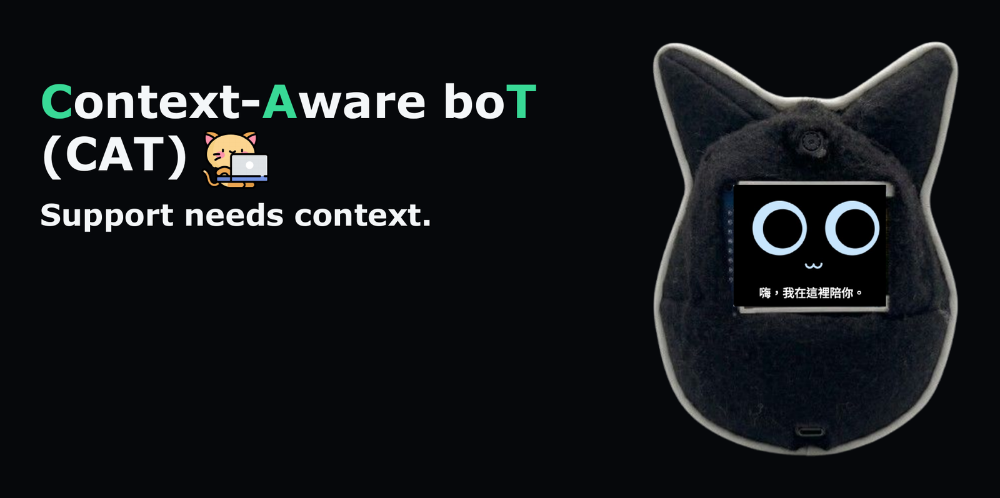
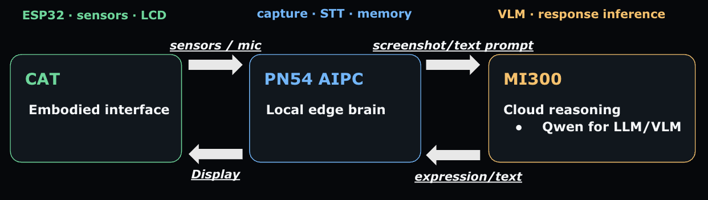

<p align="center">
  
</p>

# Context-Aware boT (CAT)

> Support needs context.

CAT is a physical desk companion that watches how your work is actually going, remembers it,
and responds when you reach out to it. Instead of answering "I'm stuck on my homework" with
generic advice, it can answer with *your* context: what you have been doing, for how long,
and what you already got past.

The system spans three machines: an ESP32-based plush cat, an ASUS PN54 AI PC, and an
AMD Instinct MI300 GPU server.

<p align="center">
  
</p>

## Repository layout

| Directory | What it is |
| --- | --- |
| [`esp32-bringup/`](esp32-bringup/) | Main board firmware (PlatformIO). FSR402 ×2, MPU6050 IMU, 1.8" TFT LCD, passive buzzer, microphone. Staged `s1`…`s13` environments; `s13_companion` is the full build. |
| [`esp32-cam-bringup/`](esp32-cam-bringup/) | Secondary ESP32-CAM board used by the homework photo flow. |
| [`ai-pc-agent/`](ai-pc-agent/) | The orchestrator on the PN54. Gesture detection, STT bridge, memory store + RAG, prompt assembly, ESP32 WebSocket link. |
| [`stt/`](stt/) | Local Breeze-ASR-25 speech-to-text service (Taiwanese Mandarin with Mandarin–English code switching), CPU or AMD ROCm. |
| [`mi300-deploy/`](mi300-deploy/) | FastAPI service in front of Ollama on the MI300, plus the model benchmark harness. |
| [`docs/`](docs/) | Design notes: [`memory.md`](docs/memory.md), [`api.html`](docs/api.html), [`HANDOFF_TODO.md`](docs/HANDOFF_TODO.md). |
| [`problem/`](problem/) | The AMD hackathon problem statement and reference material. |

## Models

| Role | Model | Runs on |
| --- | --- | --- |
| Speech-to-text | Breeze-ASR-25 | PN54 (CPU or ROCm) |
| Text embedding | `BAAI/bge-m3` | PN54 |
| Screen understanding (VLM) | `qwen3.6:35b-a3b-q8_0` (MoE, ~38.7 GB, Q8_0) | MI300 |
| Conversational reply (LLM) | `qwen2.5:7b-instruct` | MI300 |

The 35B VLM is why the MI300 is in the picture at all — at Q8_0 it does not fit on the laptop.
Everything latency- or privacy-sensitive stays local: expressions render on the ESP32,
speech recognition and the long-term memory database never leave the PN54.

Deployed model details and the switch history are in
[`mi300-deploy/bench/DEPLOYED_MODEL.md`](mi300-deploy/bench/DEPLOYED_MODEL.md).

## How it works

### 1. Passive monitoring → memory

`screen_watcher.py` polls desktop state every 10 s (foreground app, window title, process
names, idle time) and captures a screenshot every 30 s. Raw keyboard and mouse input are
never collected.

A screenshot is sent to the MI300 only when `ChangeDetector` sees a meaningful change, and
never more often than once per 60 s. The VLM returns a short description of what the screen
is doing right now; timing, merging, importance and embeddings are all computed locally by
[`ai-pc-agent/memory/store.py`](ai-pc-agent/memory/store.py). The MI300 receives the image as
base64 in the request body and never writes it to disk.

### 2. User wakes CAT

1. The ESP32 streams telemetry every 50 ms. `sensing/gestures.py` turns the raw FSR and IMU
   values into `squeeze` / `pat` / `shake` / `lift` / `putdown` plus a 0–1 intensity, on the PN54.
2. Speech goes to the local Breeze-ASR-25 service over WebSocket.
3. `memory/retrieve.py` runs hybrid retrieval — bge-m3 cosine similarity (0.7) blended with
   SQLite FTS5 BM25 (0.3), scaled by time decay and per-source importance — and takes the
   top 5 memories.
4. `prompt.py` assembles user profile, recent state, retrieved memories, the touch event and
   the utterance into a text prompt for `qwen2.5:7b-instruct`.
5. The model returns `{"expr": <one of 9 expressions>, "text": <short reply>}`. The agent
   streams it to the ESP32 as `SayCommand`, and the LCD shows the face and the caption.

Sending an empty `user_text` signals a proactive utterance, where the model decides whether
to speak at all.

## Running it

### MI300 service

```bash
cd mi300-deploy
docker build -t cat-mi300 .
docker run --rm -p 8000:8000 --device /dev/kfd --device /dev/dri cat-mi300
curl localhost:8000/health
```

`/health` reports the active `text_model` and `vision_model`. `VISION_MODEL` and `TEXT_MODEL`
override the defaults; `/model-lab` is a browser page for stateless prompt and image experiments.

Endpoints: `/v1/screen-observations`, `/v1/chat/completions`, `/v1/homework-analyses`,
`/analyze/screen`, `/models`, `/model-lab`.

### STT service

```bash
cd stt
python3 -m venv .venv-rocm && .venv-rocm/bin/python -m pip install -r backend/requirements.rocm.txt
./start_rocm.sh          # or the CPU baseline, see stt/README.md
```

Listens on `ws://127.0.0.1:8765/ws/audio`.

### PN54 agent

```bash
sudo apt install xdotool xprintidle x11-utils procps
cd ai-pc-agent && python3 -m pip install -r requirements.txt

export MI300_API=http://localhost:8000        # via ssh -L port forward
export ESP32_WS_URL=ws://192.168.4.1:81/api/v1/stream

python3 screen_watcher.py                     # passive screen → memory loop
python3 main.py                               # sensors, STT, RAG, replies
```

Every tunable lives in [`ai-pc-agent/config.py`](ai-pc-agent/config.py). A debug dashboard
runs from [`debug_api.py`](ai-pc-agent/debug_api.py) on port 8090 (`http://localhost:8090/`):

- connection status of the ESP32 WebSocket, the STT service, the MI300 and the ESP32-CAM, and
  which commit each machine is running
- live FSR / IMU readings next to the gesture thresholds, including the shake peak-to-peak value
- microphone level and VAD state reported by the STT service
- what the LCD is supposed to be showing (the last expression and caption that were sent)
- test triggers that need no hardware: gesture injection, a manual expression, and a
  `say` / `expr` / `buzz` sender for the ESP32 WebSocket
- memory inspection, retrieval tracing and a homework-flow test

### Firmware

```bash
cd esp32-bringup
pio run -e s13_companion -t upload
```

The `s1`…`s12` environments bring up one peripheral at a time and are useful when
diagnosing hardware. Pin assignments and the FSR divider rationale are documented in
[`include/board_config.h`](esp32-bringup/include/board_config.h).

> **Networking for demos:** the ESP32-CAM only joins an external hotspot (STA mode), and a
> laptop cannot be on two Wi-Fi networks at once. Put the main board in STA mode as well
> (`TELEMETRY_USE_STA 1` in `esp32-bringup/include/telemetry_local.h`) and attach all three
> devices to the same hotspot. Both boards announce themselves over mDNS once connected, so
> you can use stable names instead of DHCP addresses:
>
> ```bash
> export ESP32_WS_URL=ws://esp32-companion.local:81/api/v1/stream
> export ESP32_CAM_BASE_URL=http://esp32-cam.local
> ```
>
> If the PN54 cannot resolve `.local` names, install `avahi-daemon libnss-mdns`, or read the
> IP addresses from the boards' Serial Monitor and put those in the URLs instead. Without these
> variables the defaults only fit a main board running its own SoftAP (`192.168.4.1`) without
> the camera.

## Privacy

The design rule: **the cloud only runs inference; everything that is remembered stays on the PN54.**

- **The MI300 stores nothing.** The inference service is stateless: no database, no files, no
  cache, no conversation history. Screenshots, transcripts and prompts exist only in the request
  handler's memory while the model runs and are dropped once the response is sent, so a restart
  leaves nothing behind.
- **Memory and speech stay on the PN54.** The long-term memory database (`DB_PATH`, default
  `data/memory.db`), the bge-m3 vector index and speech recognition all run locally. Raw
  microphone audio never leaves the PN54.
- **Retrieval runs on the PN54, before anything is sent.** To answer the user, the PN54 searches
  its own memory and assembles the prompt locally; the MI300 cannot query the memory store. A reply
  request contains only: the profile facts, the current app and activity, the 10 most recent memory
  lines, the top-5 retrieved memories, the touch event and the user's utterance. The rest of the
  memory is never uploaded.
- **Screen observations.** To describe the screen, the PN54 sends a screenshot together with the
  foreground app, window title, workspace, running app names and idle time. The MI300 returns a
  text description and discards the image; the description goes into the PN54's memory.
  Homework photos from the ESP32-CAM and the spoken transcript are handled the same way.
- Raw keystrokes and mouse input are never captured.
- Screenshots **are** written to `./screenshots/` on the PN54 (`SCREENSHOT_DIR`, gitignored).
  Files older than `SCREENSHOT_RETENTION_MINUTES` (default 10) are deleted each time a new
  screenshot is taken.
- **Exception: homework help.** The homework flow pastes the generated prompt into a ChatGPT tab
  the user already has open in their own browser. That text then falls under ChatGPT's own history
  and retention settings, not CAT's.

## Tests

```bash
cd ai-pc-agent && python3 -m pytest
cd mi300-deploy && python3 -m pytest app
```

## Hardware

- ESP32 DevKit V1
- FSR402 force sensors ×2, with 47 kΩ dividers (measured to be far more sensitive than the
  original 10 kΩ at light-to-medium pressure)
- MPU6050 IMU
- 1.8" TFT LCD (ST7735)
- Passive buzzer, microphone
- ESP32-CAM secondary board
- ASUS PN54 AI PC
- AMD Instinct MI300

## DEMO video
<https://drive.google.com/file/d/1cv1Il0gi8fA3fAf0VSBaQNPkc3Bl0MWu/view?usp=drivesdk>
